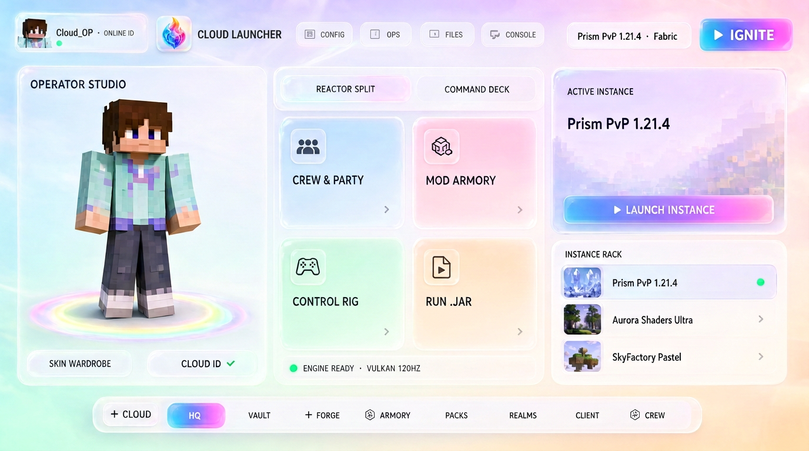
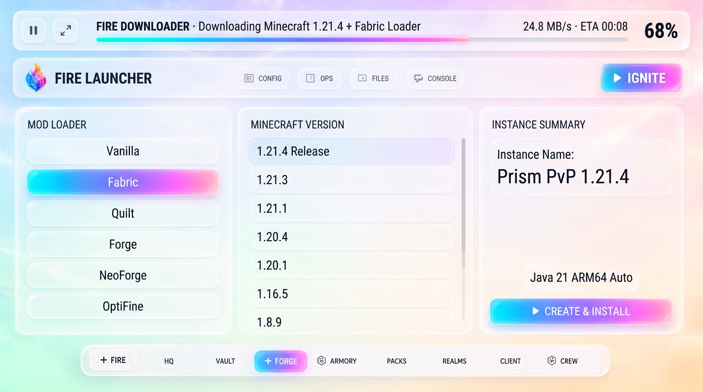
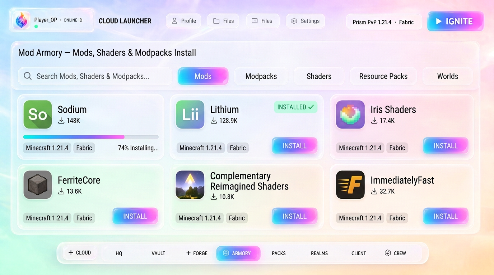
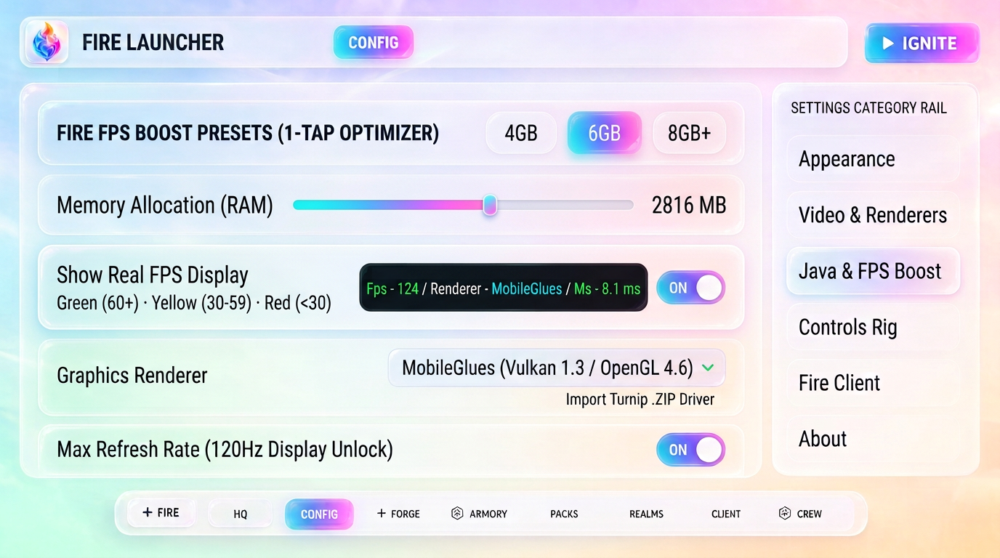
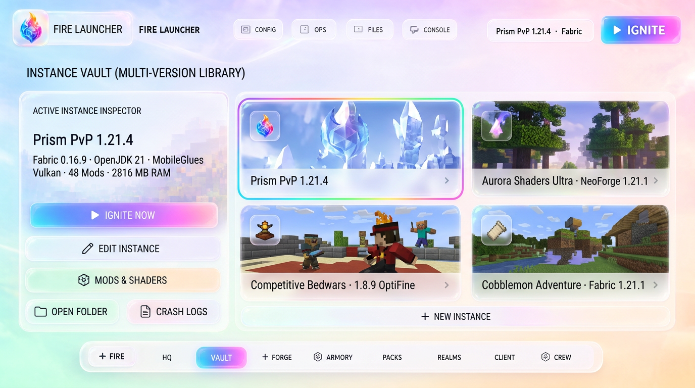
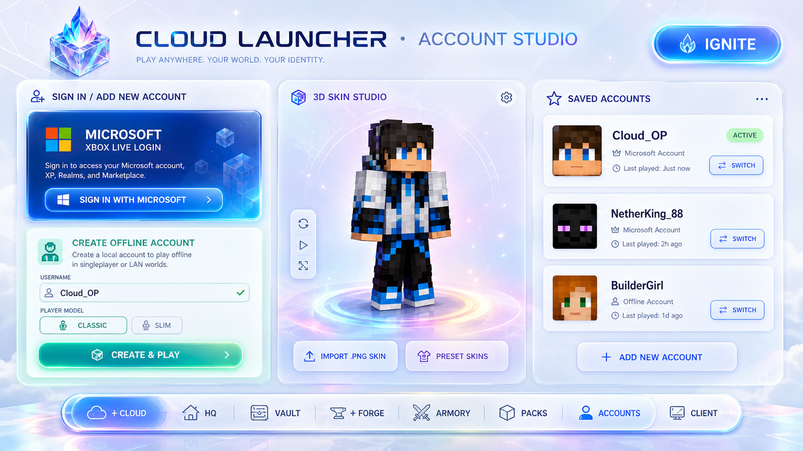
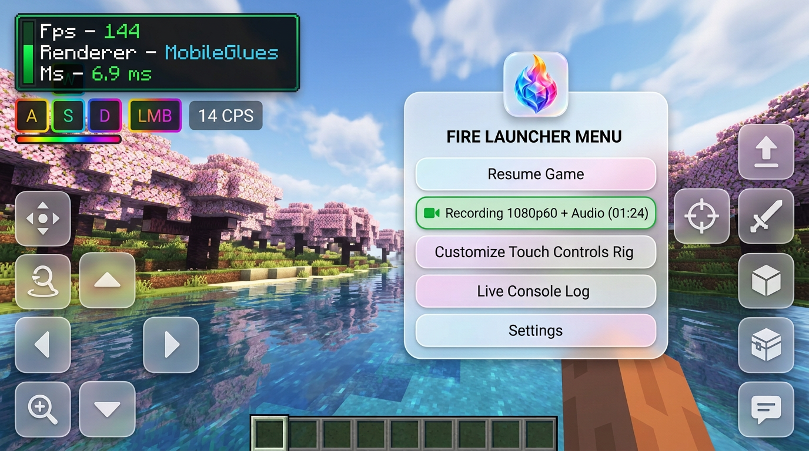
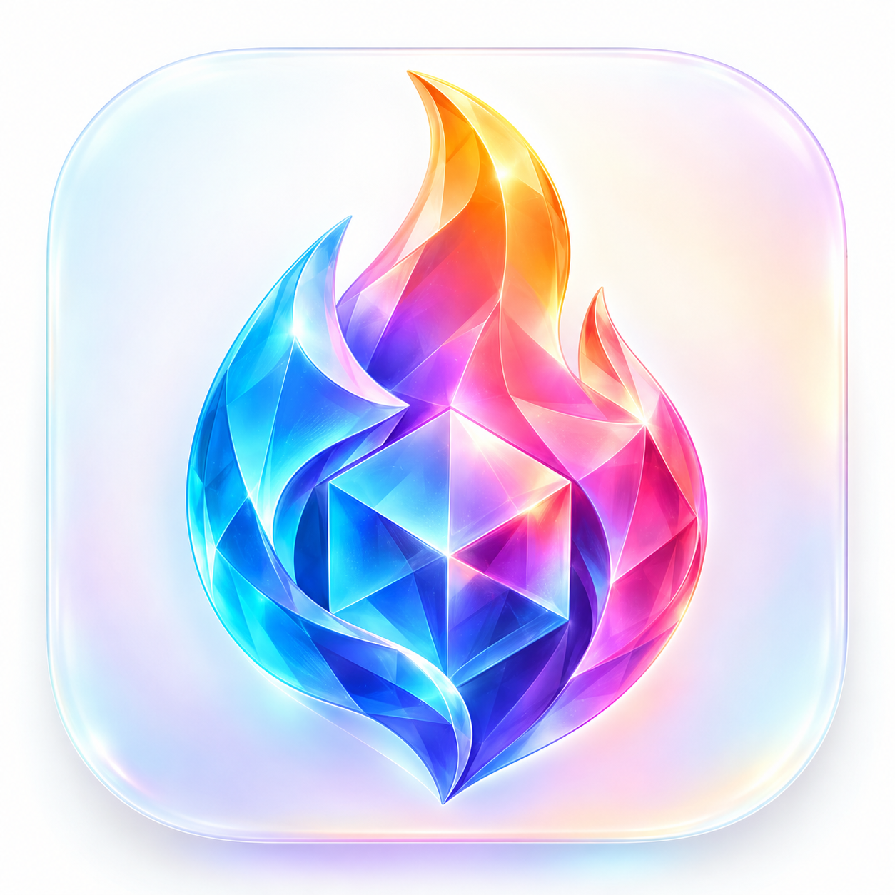

# 🔥 FIRE LAUNCHER — Complete All-UI Visual Showcase

Neeche **FIRE LAUNCHER** me lagi hui **saari 7 Prism Light Multi-Color UI Screens + Official 3D Flame-Cube Logo** ek saath di gayi hain:

---

## 1. HQ Home Dashboard (`3-Wing Bento Deck`)
- **Top Command Header**: Account Pod (`ONLINE ID`) + **FIRE LAUNCHER** Logo + `CONFIG / OPS / FILES / CONSOLE` + Active Instance + **`▶ IGNITE`**
- **Center 3-Wing Stage**: Left `OPERATOR STUDIO` (3D Skin & Rainbow Aura), Center `2×2 Pastel Bento Cards` (`CREW & PARTY`, `MOD ARMORY`, `CONTROL RIG`, `RUN .JAR`), Right `ACTIVE INSTANCE` + `INSTANCE RACK`
- **Bottom Floating Dock**: `FIRE LAUNCHER`, `HQ`, `VAULT`, `+ FORGE`, `ARMORY`, `PACKS`, `REALMS`, `CLIENT`, `CREW`

---

## 2. Version & Mod Loader Install (`+ FORGE`) + Top Downloading Bar
- **Top Relocated Downloading Bar**: Left Pause/Expand buttons, Center **`FIRE DOWNLOADER · Downloading Minecraft 1.21.4 + Fabric Loader`** + Multi-Color Cyan-Indigo-Pink Progress Bar + `24.8 MB/s · ETA 00:08`, Right **`68%`**
- **3-Column Installer**: Mod Loader (`Vanilla`, `Fabric`, `Quilt`, `Forge`, `NeoForge`, `OptiFine`), Minecraft Version (`1.21.4` se `1.8.9`), aur Instance Summary (`Java 21 ARM64 Auto` + `CREATE & INSTALL`)

---

## 3. Mods, Shaders & Modpacks Install (`✦ ARMORY`)
- Built-in **Modrinth + CurseForge** browser (`Mods`, `Modpacks`, `Shaders`, `Resource Packs`, `Worlds`)
- Live installing progress bar (`Sodium — 74% Installing...`), `INSTALLED ✓` status (`Lithium`), aur 1-tap `INSTALL` buttons (`Iris Shaders`, `FerriteCore`, `Complementary Reimagined`, `ImmediatelyFast`)

---

## 4. Settings, Show Real FPS Display Toggle & 4GB / 6GB / 8GB+ FPS Boost (`⚙ CONFIG`)
- **Inverted Right Category Rail**: `Appearance`, `Video & Renderers`, `Java & FPS Boost`, `Controls Rig`, `Fire Client`, `About`
- **Show Real FPS Display (`ON / OFF`)**: Settings me ON/OFF switch + live preview (`Fps - 124 / Renderer - MobileGlues / Ms - 8.1 ms`) with `Green (60+) · Yellow (30-59) · Red (<30)` color states
- **1-Tap Optimizer Card**: **`4GB`**, **`6GB`**, **`8GB+`** FPS Boost presets, Smooth RAM Allocation Slider, `MobileGlues` + `Turnip .ZIP Driver`, aur `120Hz Display Unlock ON`

---

## 5. Instance Vault (`❖ VAULT` — Multi-Version Library)
- **Left Active Instance Inspector**: `Prism PvP 1.21.4` (`Fabric 0.16.9 · OpenJDK 21 · MobileGlues Vulkan · 48 Mods · 2816 MB RAM`) + `IGNITE NOW`, `EDIT INSTANCE`, `MODS & SHADERS`, `OPEN FOLDER`, `CRASH LOGS`
- **Right Instance Grid**: Multiple isolated instances (`Prism PvP 1.21.4`, `Aurora Shaders Ultra`, `Competitive Bedwars 1.8.9`, `Cobblemon Adventure`)

---

## 6. Accounts, 3D Skin/Cape Wardrobe & Fire Client HUD (`◆ CLIENT`)
- **3D Skin & Cape Wardrobe**: 3D rotatable character + pastel cape + rainbow ring
- **Account Vault**: `Microsoft Xbox Live (Active ✓)`, `Ely.by Skin Server`, `+ Add Offline Username`
- **Fire Client PvP & HUD Modules**: `120Hz FPS Pill`, `RGB Keystrokes + CPS`, `ToggleSprint`, `Zoom`, aur `1080p60 Internal Audio Recorder`

---

## 7. In-Game Real FPS Display Box (`Fps / Renderer / Ms`) & Floating `FIRE LAUNCHER MENU`
- Top-left **Color-Shifting Real FPS Display Box**:
  - `Fps - 144` (**Green** 60+ · **Yellow** 30–59 · **Red** <30)
  - `Renderer - MobileGlues`
  - `Ms - 6.9 ms` (**Green / Yellow / Red** real frame-time milliseconds)
- **RGB Keystrokes + `14 CPS`**, frosted touch controls, aur floating **3D Crystalline Prismatic Flame** button se khulne wala **`FIRE LAUNCHER MENU`**

---

## 8. Official `FIRE LAUNCHER` 3D Prismatic Flame + Cube Logo

